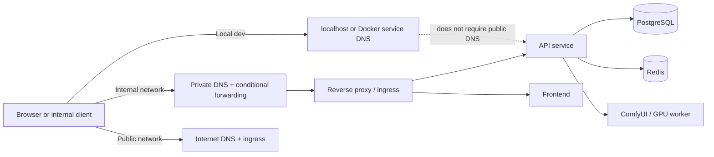

# DNS and Domain Design for OJU Video Forge

## Purpose

This document defines how the application namespace, Active Directory namespace, and local development environment are separated. The application uses `olutechsys.com` as its public-facing namespace while leaving `ojuidc.olutech.systems` reserved for infrastructure and Active Directory identities.

## Canonical assignments

- AD DNS and internal identity domain: `ojuidc.olutech.systems`
- Public application domain: `olutechsys.com`
- Video web frontend: `video.olutechsys.com`
- Video REST API: `video-api.olutechsys.com`
- Open WebUI: `chat.olutechsys.com`
- GPU host: `gpu01.ojuidc.olutech.systems` (proposed logical identity only)
- Rendering host: `render01.ojuidc.olutech.systems` (proposed logical identity only)

These hostnames are design targets, not verified runtime DNS records. They must not be treated as existing records without separate validation.

## Split-DNS design

### Internal network

The internal network should resolve the application names to private ingress or reverse-proxy resources. Example approach:

- `video.olutechsys.com` -> private application gateway or reverse proxy
- `video-api.olutechsys.com` -> private API ingress
- `chat.olutechsys.com` -> private browser gateway to Open WebUI
- `gpu01.ojuidc.olutech.systems` and `render01.ojuidc.olutech.systems` remain internal infrastructure names and are not exposed publicly

### External access

Public resolution for the application names should remain disabled by default. HTTPS ingress should only be enabled after:

- ingress security review
- TLS termination and certificate validation
- authorization and WAF review
- external access acceptance tests and explicit approval

The public API remains disabled until those checks are complete.

## Proposed DNS records

| Record | Purpose | Notes |
| --- | --- | --- |
| A/AAAA `video.olutechsys.com` | Frontend address | points to authenticated ingress or private gateway |
| A/AAAA `video-api.olutechsys.com` | HTTPS API entry point | public access disabled by default |
| A/AAAA `chat.olutechsys.com` | Open WebUI ingress | only if approved |
| CNAME `gpu01.ojuidc.olutech.systems` | GPU host logical identity | internal only; not a public service |
| CNAME `render01.ojuidc.olutech.systems` | rendering host logical identity | internal only; not a public service |
| TXT or SRV records for service discovery | optional integration testing | use only after review |

## Name resolution flow

## Application and infrastructure separation

- `ojuidc.olutech.systems` is explicitly reserved for Active Directory, Kerberos, LDAP, and domain-controller operations.
- `olutechsys.com` is the public application namespace and must not depend on the AD DNS zone.
- Local development must use `http://localhost:5173`, `http://localhost:8000`, and Docker service names such as `http://api:8000` without requiring AD integration.
- Do not create an internal authoritative `olutechsys.com` zone without evaluating the effect on public name resolution and global record precedence.

## TLS and security requirements

- Use TLS termination at the reverse proxy or public ingress layer.
- Keep PostgreSQL, Redis, ComfyUI, and worker services on private Docker networks.
- Never publish internal-only services to the public internet.
- Require authenticated ingress for external API access.
- Use verified certificates for any public endpoint; do not infer trust from the domain name alone.

## DNS verification and rollback

Before making changes in production or staging:

1. Inventory existing authoritative zones and records.
2. Confirm whether `olutechsys.com` is already delegated externally.
3. Validate whether a private split-DNS override is needed for internal clients.
4. Record names, TTLs, and change windows before cutover.
5. Prepare rollback steps to revert conditional forwarding or internal overrides.

Rollback should restore the prior resolver configuration and re-enable localhost-only development without touching AD or the authoritative AD DNS zone.

## Local-first development note

Local development continues to operate without public DNS access. Application URLs are intentionally configuration-driven and should resolve to the values in `.env` or `.env.development.example` rather than hardcoded hostnames.
